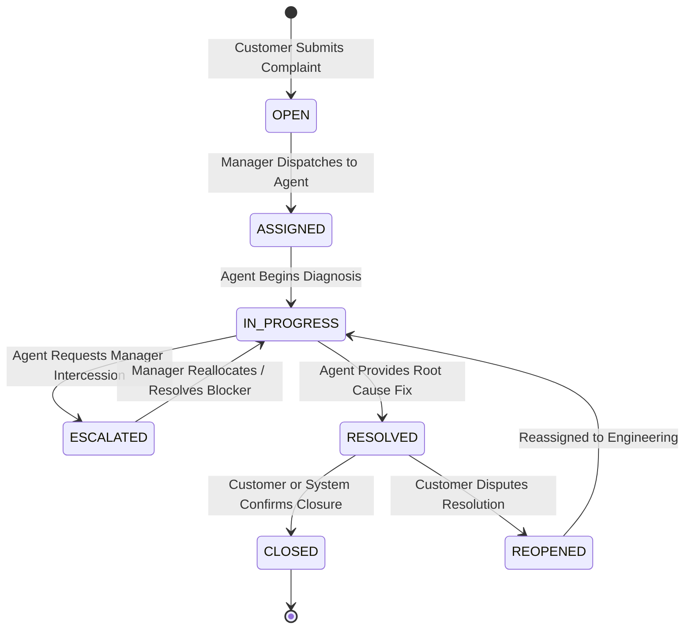
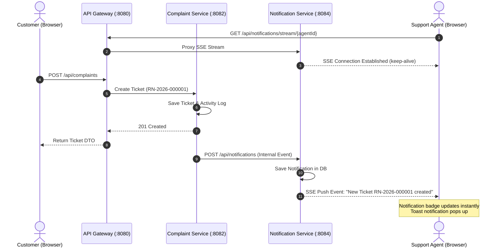
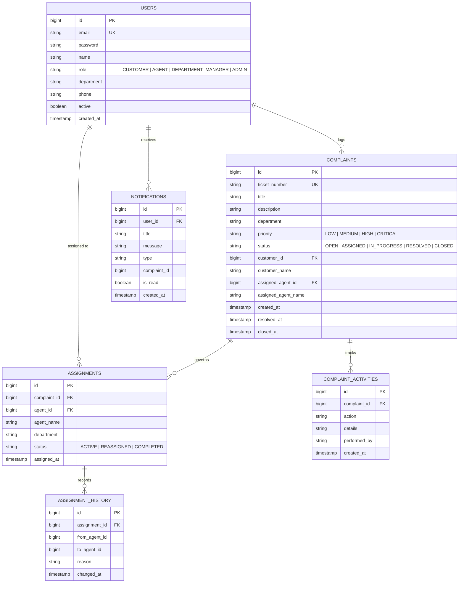

# ResolveNow – Technical Architecture & System Design Document

## 1. System Context & Component Architecture

ResolveNow utilizes a distributed microservices mesh architecture orchestrated through **Netflix Eureka** service discovery and ingress-routed by **Spring Cloud API Gateway**.

```mermaid
flowchart TD
    Client["React 19 SPA (Pure JSX)<br/>Browser Client :5173 / :3000"]
    Gateway["Spring Cloud API Gateway<br/>Reactive Netty :8080"]
    Eureka["Eureka Discovery Registry<br/>Spring Cloud Netflix :8761"]
    
    subgraph Microservices Mesh
        Auth["Auth Service<br/>Spring Boot :8081"]
        Complaint["Complaint Service<br/>Spring Boot :8082"]
        Assignment["Assignment Service<br/>Spring Boot :8083"]
        Notification["Notification Service<br/>Spring Boot :8084"]
    end

    DB[("PostgreSQL 17 Database<br/>resolvenow_db :5432")]

    Client -->|REST & SSE HTTP Requests| Gateway
    Gateway <-->|Heartbeat & Route Resolution| Eureka
    Auth <-->|Register & Discover| Eureka
    Complaint <-->|Register & Discover| Eureka
    Assignment <-->|Register & Discover| Eureka
    Notification <-->|Register & Discover| Eureka

    Gateway -->|/api/auth/**| Auth
    Gateway -->|/api/complaints/**| Complaint
    Gateway -->|/api/assignments/**| Assignment
    Gateway -->|/api/notifications/**| Notification

    Complaint -->|@LoadBalanced RestClient| Assignment
    Complaint -->|@LoadBalanced RestClient| Notification
    Assignment -->|@LoadBalanced RestClient| Notification

    Auth -->|JPA / JDBC| DB
    Complaint -->|JPA / JDBC| DB
    Assignment -->|JPA / JDBC| DB
    Notification -->|JPA / JDBC| DB
```

---

## 2. Ticket Lifecycle State Machine

The Complaint Microservice enforces strict lifecycle validation preventing invalid or premature ticket state jumps:



### State Transition Validation Rules
| From State | To State | Trigger / Permission | Side Effects |
| :--- | :--- | :--- | :--- |
| `OPEN` | `ASSIGNED` | Manager / Admin Assignment | Creates Assignment record, notifies Agent |
| `ASSIGNED` | `IN_PROGRESS` | Assigned Agent starts work | Emits SSE status event, updates timestamps |
| `IN_PROGRESS`| `RESOLVED` | Assigned Agent completes fix | Logs resolution remarks, notifies Customer |
| `RESOLVED` | `CLOSED` | Customer accepts / Auto-close | Sets `closedAt`, finalizes audit trail |
| `RESOLVED` | `REOPENED` | Customer disputes within SLA | Alerts Department Manager, sets to `IN_PROGRESS` |
| `*` | `ESCALATED` | Any state before Resolved | Escalation record logged, alerts Supervisor |

---

## 3. Real-Time Server-Sent Events (SSE) Sequence

Instead of heavy WebSocket handshakes, ResolveNow employs unidirectional **Server-Sent Events (SSE)** via Spring Web `SseEmitter` which seamlessly traversals Spring Cloud Gateway WebFlux proxies without connection drops.



---

## 4. Database Entity-Relationship Model



---

## 5. Security & JWT Lifecycle

1. **Authentication**:
   - `POST /api/auth/login` receives credentials.
   - Spring Security authenticates through `DaoAuthenticationProvider` with `BCryptPasswordEncoder`.
   - `JwtTokenProvider` builds a signed HMAC-SHA256 token containing `userId`, `email`, and `role`.
2. **Authorization**:
   - `JwtAuthenticationFilter` intercepts requests on protected routes.
   - Extracts Bearer token from `Authorization` header.
   - Populates `SecurityContextHolder` with `UsernamePasswordAuthenticationToken` and granted authorities (`ROLE_ADMIN`, `ROLE_CUSTOMER`, etc.).
   - Method-level `@PreAuthorize` guards sensitive endpoints.
3. **Frontend Token Handling**:
   - Stored securely in `localStorage` under `resolvenow_token`.
   - Axios request interceptor automatically injects `Authorization: Bearer <token>`.
   - Axios response interceptor intercepts HTTP 401 and auto-clears session, redirecting to `/login`.

---

## 6. High Availability & Resilience Features

- **Decoupled Failure Domains**: Failure of the `Notification Service` does not crash complaint creation or assignment dispatching; calls are wrapped in non-blocking try-catch blocks with fallback logging.
- **Connection Pooling**: PostgreSQL connections managed via **HikariCP** with leak detection thresholds and active healthcheck validations.
- **Client-Side Resilience**: Frontend SSE connections detect disconnects and retry with exponential backoff.
